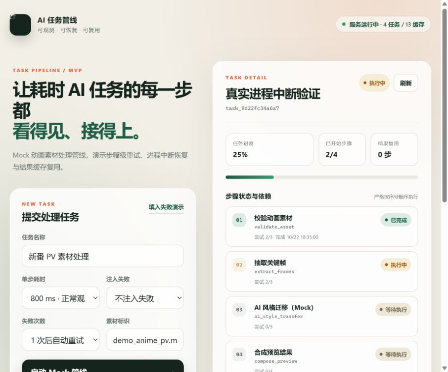

# 可观测 AI 任务管线 MVP

开发笔试题 **题 D：任务管线可观测方向** 的实现。项目以“动画素材处理”为例，用 Mock 步骤模拟耗时 AI 计算，重点展示：

- 任务与步骤级状态持久化
- 步骤级自动重试与人工重试
- 进程中断后的恢复
- 已完成步骤的结果复用
- 面向调用方的查询接口与可视化状态页
- 可解释的失败处理与执行历史



项目仅使用 Python 标准库，无第三方依赖。单进程 worker + SQLite 的设计刻意保持简单，符合题目“同等结果下，更简单、更可控、更容易解释其正确性的方案得分更高”的要求。

## 快速运行

要求：Python 3.10 及以上。

```powershell
cd D:\Study\1\lingtu-pipeline
python -m pipeline_app
```

打开 <http://127.0.0.1:8000>。

指定端口或数据目录：

```powershell
python -m pipeline_app --host 0.0.0.0 --port 8000 --data-dir .\data
```

运行测试：

```powershell
python -B -m unittest discover -s tests -v
```

当前自动化测试覆盖 5 类场景：

1. 正常任务按顺序完成
2. 单步骤失败后自动重试，已成功步骤不重跑
3. 进程重启后恢复 `running` 步骤
4. 相同输入复用已有步骤结果
5. 重试次数耗尽后任务进入 `failed`

## 时间规划

计划排期如下（实际提交时可根据真实耗时调整）：

| 阶段                   | 预计耗时 | 产出                   |
| ---------------------- | -------: | ---------------------- |
| 需求拆解与状态机设计   |    2小时 | 状态、依赖、失败场景   |
| SQLite 表结构与 worker |   3 小时 | 可持久化的任务执行管线 |
| HTTP API 与状态页      |   3 小时 | 上游可查询、可观察界面 |
| 测试与故障验证         |    2小时 | 5 个自动化测试         |
| 文档、截图和提交检查   |    2小时 | README 与演示材料      |

## 架构

```text
Browser / API caller
        |
        | HTTP JSON + status polling
        v
ThreadingHTTPServer
        |
        +---- GET/POST task APIs
        |
        v
PipelineService (single-process worker)
        |
        +---- claim next runnable step (SQLite transaction)
        +---- MockStepRunner (replaceable by real AI step)
        +---- cache lookup by deterministic cache key
        |
        v
SQLite: tasks / steps / step_history / result_cache
Filesystem: data/results/<sha256>.json
```

## 目录结构

```text
lingtu-pipeline/
├─ pipeline_app/
│  ├─ db.py              # SQLite 表结构与事务操作
│  ├─ pipeline.py        # worker、Mock 步骤、缓存
│  ├─ server.py          # HTTP API 与静态文件服务
│  └─ __main__.py
├─ static/               # 原生 HTML/CSS/JS 状态页
├─ tests/                # 自动化测试
├─ data/                 # 运行时数据库和结果文件
└─ README.md
```

### 为什么用单进程 worker + SQLite

- 题目不要求完整分布式调度系统。
- 单进程模型更容易证明正确性，调试和面试讲解成本更低。
- SQLite `BEGIN IMMEDIATE` 保证步骤领取、状态变更和任务汇总在一个事务中完成。
- 任务耗时较长时可以替换为 Celery、Temporal 或消息队列，但当前 MVP 不需要为此增加复杂度。

## 任务步骤与依赖

当前 Mock 管线包含 4 个顺序步骤：

| 序号 | 步骤 | 作用 | 是否适合独立恢复 |
|---:|---|---|---|
| 1 | `validate_asset` | 校验素材格式和元数据 | 适合，纯输入校验 |
| 2 | `extract_frames` | 抽取关键帧 | 适合，结果可按输入哈希缓存 |
| 3 | `ai_style_transfer` | 模拟 GPU/模型风格迁移 | 适合，耗时且成本高，应保存中间结果 |
| 4 | `compose_preview` | 合成预览结果 | 适合，依赖前面全部产物 |

依赖关系采用最简单的严格顺序模型：

```text
validate_asset -> extract_frames -> ai_style_transfer -> compose_preview
```

领取下一步时，SQLite 查询会检查同一任务是否存在尚未成功的更早步骤。只有所有前序步骤均为 `succeeded`，当前步骤才可执行。这样无需额外实现 DAG 调度器，又能保证依赖正确。

真实 AI pipeline 中可以进一步把每个步骤定义为带 `inputs / params / version` 的独立任务；只要这些字段能生成稳定哈希，就可以复用结果。

## 状态设计

### 任务状态

```text
pending -> running -> succeeded
                    -> failed
```

- `pending`：等待 worker 领取
- `running`：至少一个步骤正在执行
- `succeeded`：所有步骤成功
- `failed`：某一步骤达到最大重试次数

### 步骤状态

```text
pending -> running -> succeeded
                    -> pending（可自动重试）
                    -> failed（重试耗尽）
```

任务状态由步骤状态汇总得出，避免任务状态和步骤状态长期不一致。

### 持久化字段及原因

持久化在 SQLite 中的核心信息：

- 任务：`id / title / input_json / status / error / created_at / updated_at`

- 步骤：`seq / name / status / attempts / max_attempts / output_path / last_error / started_at / finished_at / next_retry_at / reused`

- 历史：每次开始、成功、失败、重试、恢复和人工重试都写入 `step_history`

- 缓存：`cache_key -> output_path / step_name / created_at

  选择这些字段的原因：

- `input_json`：进程重启后仍能恢复任务定义。

- `attempts / max_attempts`：防止无限重试，并支持面试时解释重试策略。

- `next_retry_at`：失败后不是忙等，而是按时间重新进入可执行队列。

- `output_path`：上一步结果可作为下一步输入，也支持缓存复用。

- `step_history`：状态不是只有最终值，还保留“为什么变成这个状态”的证据。

- `reused`：明确区分真实执行和缓存命中，避免虚报执行次数。


## 失败恢复策略

| 场景 | 系统行为 | 面试时如何解释 |
|---|---|---|
| 单步骤临时失败 | 步骤回到 `pending`，1 秒后自动重试，最多 3 次 | 将失败限定在局部，避免整条管线从头执行 |
| 重试耗尽 | 步骤变为 `failed`，任务变为 `failed` | 保留错误和执行历史，等待人工判断 |
| 进程被强制结束 | 启动时把遗留的 `running` 步骤改为 `pending` | 只有最终成功输出写完后才标记 `succeeded`，因此恢复不会把半成品当成成功 |
| 任务卡住或耗时较长 | 上游轮询任务详情，可看到当前步骤、尝试次数和开始时间 | 状态实时可见，不依赖日志猜测 |
| 相同输入重复提交 | 计算确定性 `cache_key`，命中后直接复用结果文件 | 降低重复 GPU/模型成本，并记录 `reused=1` |
| 用户手动重试失败任务 | 只重置失败步骤，已完成步骤保留并复用 | 避免重新执行昂贵的前序步骤 |

### 结果复用为什么安全

缓存键由以下内容生成：

```text
SHA256(pipeline_version + normalized_input + step_name)
```

因此，输入、步骤实现版本或步骤名称变化时不会错误命中旧结果。输出文件先写入临时文件，再原子替换为正式文件；数据库缓存记录也在结果文件落盘后写入。

当前 MVP 的已知边界：

- 缓存没有 TTL 和主动失效管理。
- 缓存键基于完整 JSON，尚未实现字段级依赖图。
- 单 worker 假设下没有 lease、heartbeat 和 fencing token。
- 这是有意的 MVP 取舍，不是分布式系统实现。

## 从秒级扩展到小时级需要改变什么

如果步骤从秒级增长到小时级，系统需要进一步考虑：

1. 使用消息队列或持久化工作流引擎，避免单进程 worker 成为单点。
2. 为运行中的步骤增加 lease 和 heartbeat；失联租约到期后才允许其他 worker 接管。
3. 使用对象存储保存大体积中间产物，数据库只保存引用和校验和。
4. 增加幂等键、步骤版本和输出完整性校验。
5. 对 GPU 任务增加队列优先级、配额、显存占用、卡号和排队时长等指标。
6. 将执行日志、指标和追踪接入 OpenTelemetry / Prometheus。
7. 上游 API 改为事件订阅或长轮询，减少高频轮询压力。

## HTTP 接口

| 方法 | 路径 | 说明 |
|---|---|---|
| `GET` | `/api/health` | 服务状态、恢复步骤数和统计信息 |
| `GET` | `/api/tasks` | 任务列表 |
| `POST` | `/api/tasks` | 创建任务 |
| `GET` | `/api/tasks/{id}` | 任务、步骤和执行历史 |
| `POST` | `/api/tasks/{id}/retry` | 人工重试失败步骤 |

创建任务示例：

```json
{
  "title": "新番 PV 素材处理",
  "asset_name": "demo_anime_pv.mp4",
  "step_delay_ms": 800,
  "fail_step": "ai_style_transfer",
  "fail_times": 1
}
```

## 如何演示三个关键场景

### 1. 步骤失败与自动重试

1. 点击“填入失败演示”。
2. 启动任务。
3. 在详情中观察 `ai_style_transfer` 第一次失败。
4. 1 秒后步骤变为 `running`，尝试次数变为 `2/3`。
5. 后续步骤继续执行，前两步不会重跑。

### 2. 进程中断与恢复

1. “单步耗时”选择 `10 s`。
2. 启动任务。
3. 在一个步骤处于 `running` 时用 `Ctrl+C` 结束服务。
4. 重新执行 `python -m pipeline_app`。
5. 刷新页面，执行历史会出现“检测到进程中断”，该步骤重新进入队列并继续。

### 3. 结果复用

1. 以相同素材标识和参数再次提交任务。
2. 第二次任务会直接命中缓存。
3. 详情中每一步显示“已复用缓存”，任务状态仍会正常完成。

## GPU 任务调度与可观察性设计

当前 MVP 为了保持简单，没有实现真实 GPU 调度；但题目的 GPU 加分项可以从以下方案补足。

### 调度模型

- 每个步骤持久化资源需求：
  - `gpu_required`
  - `gpu_count`
  - `gpu_memory_mb`
  - `gpu_type`（例如 L4 / A10 / 4090）
  - `priority`
- GPU 池维护每张卡的容量、健康状态和当前租约。
- 只有拿到 GPU lease 的步骤才能进入 `gpu_running`，其余步骤显示为 `gpu_queued`。
- 调度器按优先级、等待时间和资源匹配度选择设备；同一任务内的步骤仍按依赖顺序执行。
- worker 定期发送心跳续租；进程异常退出后 lease 过期，步骤重新进入调度队列。

### 可观察字段

每个 GPU 步骤建议记录：

- `task_id / step_id / attempt`
- `gpu_id / gpu_model`
- GPU 排队时间、开始时间、结束时间
- GPU 利用率、显存已用/预留量
- OOM、Xid、ECC 等设备错误
- 步骤耗时、失败次数和重试去向

这些字段可以同时用于任务详情接口、状态页和 Prometheus 指标，并在失败时关联到具体 GPU，而不是只留下“某个 AI 步骤失败”。

### 故障处理

| GPU 故障           | 处理方式                                              |
| ------------------ | ----------------------------------------------------- |
| worker 崩溃        | GPU lease 超时，步骤回到待调度状态                    |
| CUDA OOM           | 记录资源需求，按策略降低 batch 或换更大显存 GPU       |
| GPU Xid / ECC 错误 | 将设备标记为 unhealthy，停止分配并重试到其他设备      |
| 长时间排队         | 在任务详情中暴露 `gpu_queued`、队列位置和预计等待时间 |

这项没有在 MVP 中落地，因为它需要真实 GPU 调度环境，Mock 一个“GPU 已调度”的假状态不能证明调度正确性。因此这里明确作为方案设计，而不是伪造实现结果。

## AI coding 使用说明

- 使用的 AI coding 工具：Codex 
- 大致 token 消耗：15,458,712
- token 消耗最多的部分：整个系统的搭建和前端网页的实现
- 未使用 LLM、由个人完成且耗时最多的部分：检查确认Codex给出的解决方案，修改README文档
- 实际总耗时：两天左右

## 失败案例分析

### 1. SQLite WAL 初始化失败

- 现象：测试启动时，SQLite 报错 `cannot change into wal mode from within a transaction`，导致任务存储无法初始化。
- 原因：最初把 `PRAGMA journal_mode=WAL` 放在了已经开启的数据库事务里。SQLite 要求切换 WAL 日志模式时不能在事务中执行。
- 修复：将数据库连接、WAL 模式设置和建表流程拆开，先设置 WAL，再执行建表脚本；业务状态变更加到独立事务里。
- 验证：修复后 5 个自动化测试全部通过，任务持久化、重试和恢复流程正常。
- 反思：数据库初始化和业务事务的边界要明确，不能把所有 SQL 都简单塞进同一个事务上下文。

### 2. 进程中断恢复第一次没有被有效验证

- 现象：最初使用 3 秒 Mock 耗时并通过 `Ctrl+C` 测试中断恢复，但经常出现任务已经执行完成、日志里没有 `step_recovered` 的情况，无法证明恢复逻辑真的生效。
- 原因：3 秒太短，观察和终止进程的时机不稳定；同时 `Ctrl+C` 更接近正常退出，并不等同于任务执行中的硬中断。
- 修复：增加 10 秒的 Mock 耗时选项，使用 `Stop-Process -Force` 强制结束服务，再用相同数据目录重新启动。
- 验证：重启日志出现 `Recovered 1 interrupted step(s)`，任务历史出现 `step_recovered`，该步骤重新执行，之前已成功的步骤没有重跑。
- 现有不足：当前恢复粒度是“步骤级恢复”，不是步骤内部断点续跑。如果一个耗时步骤执行到一半被中断，该步骤会从头重新执行；这和真实 AI 任务常见的幂等重试模型一致，但如果步骤需要运行数小时，还需要 checkpoint、lease 和对象存储。
- 反思：测试恢复逻辑不能只模拟状态，必须真正制造中断，并检查数据库历史、尝试次数和最终结果。

### 3. GPU 调度加分项没有真实落地

- 现状：GPU 调度和可观察性只完成了方案设计，没有实现真实调度代码。

- 原因：当前项目没有真实 GPU 集群和模型推理环境。如果只是 Mock 一个“GPU 已调度”的假状态，无法证明资源分配、显存竞争、OOM 和设备故障处理是正确的。

  

